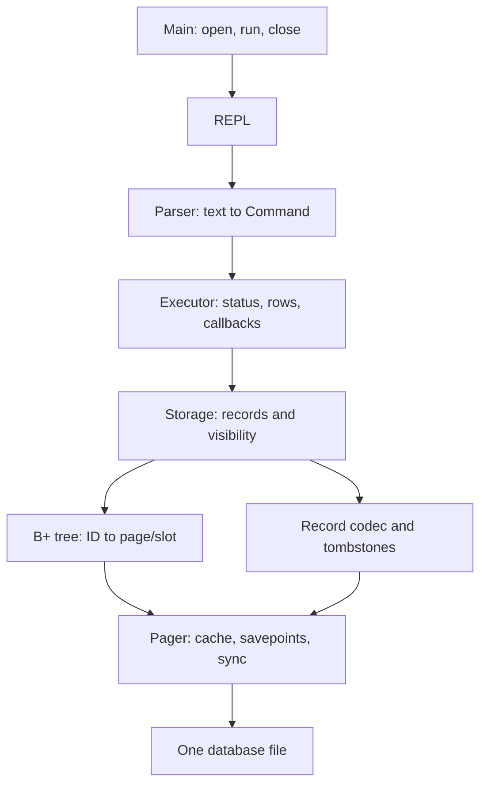

# MiniDB

## Overview

MiniDB is an educational database engine built from scratch in **C17** to study
systems programming, persistent data structures and database internals. It uses
no existing database backend or external tree library. The project demonstrates
explicit binary storage, a persistent B+ tree, query execution, fault injection
and reproducible performance experiments.

**Milestone: phase 5 engineering validation complete.** Application v0.5 uses
**disk format v3**. Debug, Release and ASan/UBSan/leak-detection runs passed all
19 Linux CTest entries in the recorded validation. These are finite test results,
not production-readiness or crash-recovery guarantees.

## Features

- INSERT, indexed SELECT, ordered SELECT_ALL, UPDATE and logical DELETE.
- Same-ID reinsertion reactivates a deleted slot without duplicating the index key.
- Six age comparisons, evaluated by scanning the ID index.
- 4096-byte pages, explicit 70-byte records, UTF-8 names and little-endian fields.
- Persistent B+ tree with leaf/internal/root splits and structural validation.
- Pager cache, dirty tracking and memory rollback for ordinary mutation failures.
- Structured Executor results, row/node callbacks, `.stats` and `.btree` inspection.
- Seeded reference-model tests, corruption/fault tests, multi-process persistence
  tests, sanitizer builds and standalone benchmarks with raw measurements.

## Architecture



The REPL coordinates parsing/execution and formats output. Executor, Storage and
BTree perform no terminal I/O. Main owns Storage; Storage owns Pager and tree
state; the tree borrows Pager. Callbacks borrow rows/nodes for the call only and
must not modify or close the database. See [architecture](docs/architecture.md) and the illustrated [visual guide](docs/visual-guide.md) for page types, data flow and indexed lookup.

## Storage Format

Page 0 stores magic, version, page size/count, root, allocated slots and active
rows. Data pages contain up to 58 records and an eight-byte tombstone bitmap.
Each record stores uint32 ID, one-byte age/name length and up to 64 name bytes.
All integers are encoded explicitly; native C structs are never dumped to disk.

The 4096-page limit caps files at 16 MiB; index pages reduce available record
capacity. Open validates and caches the entire file. **V1/v2 files are rejected
without modification; no migration is provided.** Use a fresh path for v3.
Missing/empty regular files initialize; nonempty invalid files never silently
reinitialize. See [byte offsets and consistency rules](docs/storage-format.md).

## B+ Tree Index

Leaves hold up to 340 ID/location entries; internal nodes hold up to 509
separators and 510 children. A separator equals the minimum key of its right
subtree. Binary search routes point queries; linked leaves support ordered scans.
Records remain in separate data pages, so sorted access can jump between them.

Validation checks order/uniqueness, occupancy, references, separators, equal leaf
depth, leaf links, cycles, reachability and index/record correspondence. Tombstones
retain index keys; UPDATE/DELETE/reactivation do not rebalance or rewrite the tree.
See [algorithms and invariants](docs/btree-design.md).

## Query Execution

| Command | Behavior |
| --- | --- |
| `INSERT <id> "<name>" <age>` | Insert, reject an active duplicate, or reactivate the same deleted ID |
| `SELECT <id>` | Indexed lookup; distinguish missing and logically deleted IDs |
| `UPDATE <id> "<name>" <age>` | Change an active row's name/age, preserving its ID/location |
| `DELETE <id>` | Mark an active row deleted; repeated deletion returns a controlled error |
| `SELECT_ALL` | Active rows in ascending ID order |
| `SELECT_ALL WHERE age <op> <value>` | Ordered scan with `=`, `!=`, `<`, `<=`, `>` or `>=` |
| `.stats` | Total/active/deleted rows, index entries, pages, nodes, height and session splits |
| `.btree` | Physical index, including retained deleted keys |
| `.help`, `.exit` | Help and normal close |

Keywords are case-sensitive and `age` is lowercase. Separate filter tokens with
whitespace (`age >= 21`). This is a small command language, not SQL. IDs are
0..4294967295; age/filter values 0..150; names are 1..64 valid UTF-8 **bytes** in
double quotes. ASCII controls/DEL and embedded quotes are rejected. Backslashes
are literal; there is no escaping or Unicode normalization. Signed numbers,
extra arguments, compound filters and semicolons are rejected. Input is limited
to 4096 bytes per line; overlong/NUL-containing lines are discarded completely.

Empty scans print `OK: 0 rows`. Executor returns status, affected/delivered row
count and optional statistics through a structured interface; query callbacks
may stop with an error. Age filters are **scans**, not indexed age lookups.

## Build Instructions

Linux requirements: GCC or Clang with C17/POSIX support, CMake 3.16+, Make or
Ninja, and Python 3.8+ for the process-oracle test. No Python or third-party runtime
library is required by the engine itself. The recorded platform used GCC on Arch.

```sh
cmake -S . -B build -DCMAKE_BUILD_TYPE=Debug -DBUILD_TESTING=ON
cmake --build build -j2
ctest --test-dir build --output-on-failure

cmake -S . -B build-release -DCMAKE_BUILD_TYPE=Release -DBUILD_TESTING=ON -DMINIDB_BENCHMARKS=ON
cmake --build build-release -j2
ctest --test-dir build-release --output-on-failure
```

Add `-G Ninja` on first configuration if preferred; use a new build directory to
change generator. For engine-only builds use `-DBUILD_TESTING=OFF`. Build products
and database files are ignored by Git. Clean generated products with
`cmake --build build --target clean`. Source-only clean Debug/Release builds were
also verified without an existing cache or local specification files.

## Usage

```sh
./build/minidb demo.db
```

Use a fresh filename for this example:

```text
minidb> INSERT 3 "Mariana" 25
OK: 1 row inserted
minidb> INSERT 1 "Alexis" 21
OK: 1 row inserted
minidb> INSERT 2 "José" 20
OK: 1 row inserted
minidb> UPDATE 1 "Alexis Perez" 22
OK: 1 row updated
minidb> DELETE 2
OK: 1 row deleted
minidb> SELECT_ALL WHERE age >= 21
1 | Alexis Perez | 22
3 | Mariana | 25
minidb> .exit
```

Reopen the same path: `SELECT 1` returns the update; `SELECT 2` reports logical
deletion; `INSERT 2 "José returned" 23` reactivates that slot. The reproducible
[demo input](examples/demo.txt) also prints statistics and the tree. To run a **safe two-session demonstration** with a fresh temporary database that is automatically deleted, use: 

```sh
sh scripts/demo.sh ./build/minidb
```

To run the input manually:

```sh
./build/minidb fresh-demo.db < examples/demo.txt
./build/minidb fresh-demo.db
```

`OK` acknowledges a cache change. **Check the exit status after normal `.exit` or
EOF**, which writes dirty pages and fsyncs the file. Ctrl-C is not a normal close.
Recoverable input/duplicate/missing/deleted errors allow later commands and can
still produce exit 0; fatal storage/output errors return 1. `--help` opens no DB.
For debugging: `gdb --args ./build/minidb demo.db`.

## Testing

[GitHub Actions CI](.github/workflows/ci.yml) runs all CTest suites in Debug, Release and ASan/UBSan builds on pushes to `main`, pull requests and manual dispatch. Check the Actions tab for actual results; a workflow file by itself does not prove a green run.

```sh
ctest --test-dir build -LE stress --output-on-failure
ctest --test-dir build -L stress --output-on-failure
cmake -S . -B build-sanitize -DCMAKE_BUILD_TYPE=Debug -DMINIDB_SANITIZERS=ON -DBUILD_TESTING=ON
cmake --build build-sanitize -j2
env ASAN_OPTIONS=detect_leaks=1:halt_on_error=1 UBSAN_OPTIONS=halt_on_error=1 ctest --test-dir build-sanitize --output-on-failure
```

Recorded on 2026-10-15: **19/19 Debug, 19/19 Release, 19/19 ASan+UBSan+LSan**,
with no sanitizer findings. Coverage includes 10000/100000 rows in ascending,
descending and seeded random order; a 60000-operation independent C model;
three-level tree mutations; 50000 parser and 50000 codec mutations; and ten CLI
processes comparing complete state against a Python model. Tests use temporary
files. Valgrind was unavailable. See [coverage, seeds and execution evidence](docs/testing.md)
and the [audit findings](docs/audit.md).

## Benchmarks

```sh
./build-release/benchmark_engine > /tmp/minidb-benchmark-new.csv
python3 benchmarks/summarize.py /tmp/minidb-benchmark-new.csv
```

Five measured trials per size after warm-up; same queries for both methods,
alternating execution order. Median time in milliseconds per **2000 lookups**:

| Rows | Indexed | Sequential |
| --- | --- | --- |
| 1000 | 0.322252 | 1.498043 |
| 10000 | 0.454206 | 13.297411 |
| 50000 | 0.744984 | 140.732848 |
| 100000 | 0.917055 | 287.190818 |

These are **preloaded-cache** measurements on an Intel i5-1235U, GCC 16.2.1,
Release `-O3`, not disk latency. Additional experiments measure inserts, updates,
logical deletes, reactivation, scans, age filters, open and synchronization.
The recorded `/tmp` mount is **tmpfs**, so synchronization numbers do not measure
SSD performance or durable transaction commits. See [methodology, dispersion,
complexity, profiling and raw data](docs/benchmarking.md). Phase 3 measurements
remain archived and are not directly comparable to the expanded workload.

## Engineering Decisions

- Explicit serialization separates portable disk fields from in-memory padding.
- A secondary B+ tree keeps data locations stable across node splits.
- Logical deletion avoids incomplete physical rebalance logic and preserves keys;
  its space cost and same-ID reactivation semantics are explicit.
- Pager before-images protect ordinary mutation failures without pretending to
  provide crash atomicity; disk write errors poison the handle and stop retries.
- Full validation at open prioritizes integrity and simplicity at this scale,
  at the cost of startup work and a full-file cache.
- Streaming structured results keep storage independent of terminal formatting.
- Benchmarks validate results, retain raw samples and report dispersion; no
  speculative engine microoptimization was introduced during phase 5.

See [engineering log](docs/engineering-log.md) for the implementation rationale.

## Known Limitations

Single table, fixed schema, single-process ownership, 16 MiB file cap, no cache
eviction or file locking. Tombstones do not recover space or securely erase data.
No WAL, crash recovery, ACID transactions, checksums, migration, physical deletion
with rebalancing, full SQL, joins, optimizer, replication or Oracle compatibility.
Partial writes can leave inconsistent files; validation is not automatic repair.
See [failure windows and precise guarantees](docs/limitations.md).

## Future Work

Potential separate extensions include WAL and recovery, transactional commit,
concurrency control, a bounded buffer pool, checksums, physical deletion/compaction,
format migration and a richer SQL/query layer. None is implemented or promised
as part of this milestone.

## License

MiniDB is licensed under the **MIT License**. See [LICENSE](LICENSE) for the
full license text and copyright notice.
