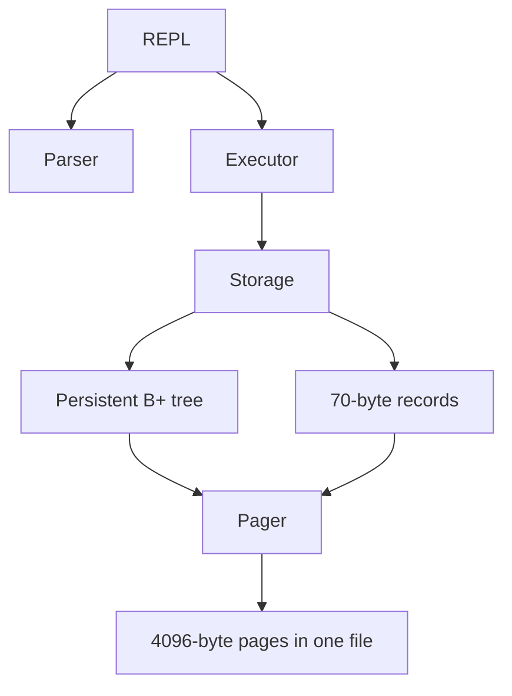

# Persistent secondary B+ tree

## Architecture



The tree maps `uint32 ID -> (data page ID, record slot)`. Records stay in heap
data pages. Leaves contain only keys and locations; internal pages contain
separators and children. SELECT always follows the tree, never a hidden sequential
fallback. The benchmark keeps a separate sequential implementation outside the
production API. SELECT_ALL now returns ascending IDs, replacing insertion order.

```text
                  internal root: [50 | 100]
                     /       |        \
                keys<50   50<=keys<100  keys>=100
                  leaf  ---> leaf  ---> leaf ---> 0
                   |          |          |
              (page,slot) (page,slot) (page,slot)
                   |          |          |
                       data records
```

Each separator is the **exact minimum key of its right subtree**. Ranges are
compared directly, without adding/subtracting one (important for 0/UINT32_MAX).
The tree uses 340-entry leaves and 509-key internal nodes, calculated from the
[actual disk fields](storage-format.md), not reduced capacities chosen for tests.

## Search

Binary search in each internal node finds the first separator strictly greater
than the query (upper bound). Its child is the search path; equality selects the
right subtree. A leaf binary search finds the first key greater than or equal to
the query (lower bound). An exact hit returns its stored location, which Storage
checks and deserializes. Missing keys leave the caller's record unchanged.

A tree of height H visits H index pages and, for a successful SELECT, one data
page. Comparison cost is O(log N). Pages are cached by the existing Pager; this
is a disk-persistent tree even though current tests and benchmarks fit in cache.

## Insertion and splits

Storage validates the record and checks duplicates through the tree before
starting a memory savepoint. It appends the row to the last data page (or a new
data page) and inserts the ID/location into the tree. The recursive insertion
returns either no split, or a `(separator, right_page)` result for its parent.

1. **Leaf without overflow:** binary-search insertion position, copy entries
   around the new tuple into a bounded temporary buffer and rewrite the leaf.
2. **Leaf overflow:** 341 sorted entries split into 170 left and 171 right. The
   right leaf inherits the old next pointer; the left points to the new right.
   Copy the right leaf's minimum key to the parent. That key remains in the leaf.
3. **Internal insertion:** add the returned separator and right child immediately
   after the child that split. Preserve all other separator/child associations.
4. **Internal overflow:** 510 keys and 511 children split around key index 255.
   Promote that key, leaving 255 keys/256 children left and 254 keys/255 children
   right. Unlike a leaf separator, the promoted key is removed from the two
   resulting internal nodes. It still exists as a record key in a descendant leaf.
5. **Root overflow:** allocate a new internal root with the promoted separator and
   the two split children. Update the metadata root ID as part of the same INSERT.

A smaller new key can only decrease the minimum along the leftmost search path;
nonleft children have an existing separator equal to their minimum, so a smaller
key would have been routed to their left neighbor. Ordinary insertion therefore
does not require unrelated ancestor separator updates. Splits introduce their
new separator explicitly.

Tree buffers and temporary key/child arrays are bounded by computed capacities.
The defensive recursion limit is 32; valid trees under the 4096-page limit have
far smaller height. Page allocation is append-only, so old page IDs never change.
There is no physical index deletion, merging, redistribution or free-page reuse.
Phase 4 logical deletion retains the entry and data slot; the same ID can be
reactivated without adding an index entry.

## Ordered scans

Descend through child 0 to the leftmost leaf, then visit each leaf's entries and
follow next pointers. For every entry Storage retrieves the referenced row and checks its tombstone.
Only active rows are emitted; Executor optionally applies an age predicate.
The tree walk is O(H + N) plus data-page accesses. The data records themselves
remain in insertion order, so sorted scans can jump between cached data pages.
A visitor failure stops the scan. Visitors borrow each record only for that call
and must not mutate/close the storage being scanned.

## Structural validation

`storage_validate` checks metadata and all data pages, then calls
`btree_validate`. A page visitation array rejects repeated child references,
cycles, data pages used as nodes and unreachable index pages. Recursive validation
returns each child's actual minimum and maximum; the parent verifies strict range
separation and exact separator equality. A shared leaf-depth value enforces
balance, and the expected-next-leaf ID checks the linked list against tree order.
All node capacities, minimum occupancy, reserved and unused bytes are checked.

Every indexed location must point to an occupied data slot with the same key.
Strictly increasing global keys and equal index/data counts establish one-to-one
coverage, without constructing an auxiliary sorted index during open. The root
may be an empty leaf; all other leaves and all internal nodes must be nonempty.
Opening validates in O(P + N) work over pages and records. Validation does not
rebuild, repair or rewrite the tree.

## Failure handling and ownership

`BTree` borrows its Pager; Storage owns both logical tree state and the Pager
lifetime. `pager_begin/write/allocate/commit/rollback` provide one nonnested
**in-memory** savepoint. Before-images are allocated lazily for existing pages;
rollback restores bytes and original dirty flags, and frees new pages. The
Storage caller restores the BTree value (root and session split counters) on
failure. Pager page buffers stay at stable addresses throughout rollback.

The savepoint makes a failed INSERT logically reversible on ordinary errors,
including a failed allocation after a lower-level split. There is no allocation
or I/O after the final publication step. Sync is prohibited during a savepoint.
Caller code must acquire writable buffers after beginning the savepoint, and
must not reuse an earlier mutable pointer to bypass before-image capture.

This is not transaction isolation, durable logging or crash recovery. The
normal-close policy and poisoned-Pager behavior after disk failures are unchanged.

## Inspection commands

- `.btree`: page ID, type, root marker, key count, leaf links and key/location
  pairs, or separator/child relationships. Indentation shows tree depth. Output
  is intentionally complete and can be large for large databases.
- `.stats`: record/page counts, data pages, internal/leaf nodes and height derived
  from validated persistent pages; then leaf/internal/root split counts for the
  current successful insertion session. Reopening resets split counters to zero.

A split event can increment both its node-type count and the root-split count;
these categories are not a disjoint total. Failed insertions restore all counts.

## Phase 4 visibility and execution

The node binary layout, key ordering and split algorithms did not change. The
file version is now v3 because data pages gained a deletion bitmap. All historical
keys, including deleted IDs, retain exactly one entry and continue to define
separator minima, leaf occupancy and tree height. Structural validation covers
both active and deleted data slots. Thus deleting the smallest key does not
require changing its separator, and deleting every active row leaves the index
structure allocated.

UPDATE changes only an active data payload, never the key or its location. DELETE
sets the data bitmap; reinsertion of the same deleted ID clears it and replaces
the payload. These operations never call tree insertion, splitting or rebalancing.
Tests compare every index page byte-for-byte before and after these operations.

`.btree` includes deleted IDs because it describes the physical index; `.stats`
reports active rows, tombstones and total index entries separately. BTree now
exposes borrowed `BTreeNodeView` objects through a visitor, rather than printing.
Storage forwards that inspection, Executor coordinates it, and only REPL formats
terminal output. The node visitor may return an error to stop traversal.

Filtering by age visits the ID-ordered index and checks active rows in Executor;
there is no index on age. Complexity remains O(H + N) in total indexed entries,
including tombstones, even when few rows match. Point searches still cost O(log N).

## Executed tests

Original eight suites remain. Binary fixture expectations were adapted to the v2
layout, `.stats` is now a valid command, scans expect ID order, and the data-only
capacity fixture was replaced with actual indexed inserts until page exhaustion.
New suites cover 10000 and 100000 ascending, descending and seeded shuffled IDs,
all successful/missing lookups, full scans against an independent model, duplicate
rejection, reopen and continued insertion including UINT32_MAX.

Observed 100000-row structures:

| Order | Height | Leaves | Internal nodes | Leaf/internal/root splits |
| --- | --- | --- | --- | --- |
| Ascending | 3 | 588 | 3 | 587 / 1 / 2 |
| Descending | 3 | 584 | 3 | 583 / 1 / 2 |
| Seeded random | 2 | 449 | 1 | 448 / 0 / 1 |

Random insertion alone does not necessarily exercise internal overflow at this
size; the ordered patterns do. The first ascending internal/root split occurs
when adding key 86870 after keys 0..86869. Fault tests inject failure at every
allocation along that INSERT and the first leaf/root split, then compare the
closed file byte for byte with its prior image. A separate case checks that
rollback preserves earlier unsynchronized inserts.

Corruption tests use a three-level tree to reject cycles, aliased/out-of-range
children, incorrect separators, unequal depths, bad leaf chains, wrong types,
under/overfull nodes, invalid record locations, orphan pages and legacy v1 files.
The phase 3 run passed all 11 CTest tests with Debug and ASan/UBSan/leak detection.
Phase 4 retains them and adds query, mixed-operation, tombstone and CLI coverage;
see the current README for the expanded verification results. See
[benchmark conditions and measurements](../benchmarks/README.md) for timing.

## Interview study topics and remaining scope

Be able to explain B-tree versus B+ tree leaf contents, secondary indexes versus
clustered data, fanout and tree height, upper/lower bounds, copied versus promoted
separators, split propagation, leaf-chain traversal, page/slot references and
structural invariants. Explain why memory rollback plus fsync is still not WAL
or an ACID commit protocol.

Phase 4 adds UPDATE and logical DELETE only. Physical deletion/rebalancing,
space reclamation, WAL/recovery, concurrent writers, eviction and migration
tooling remain future work. Do not interpret these tests as evidence of production durability.
