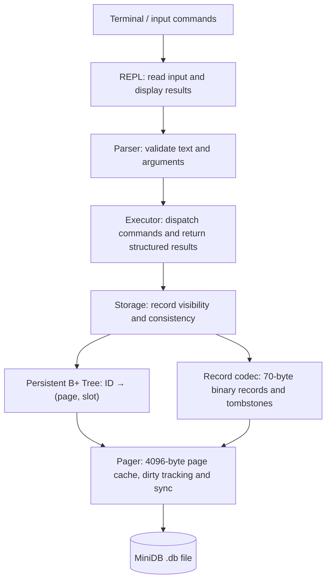
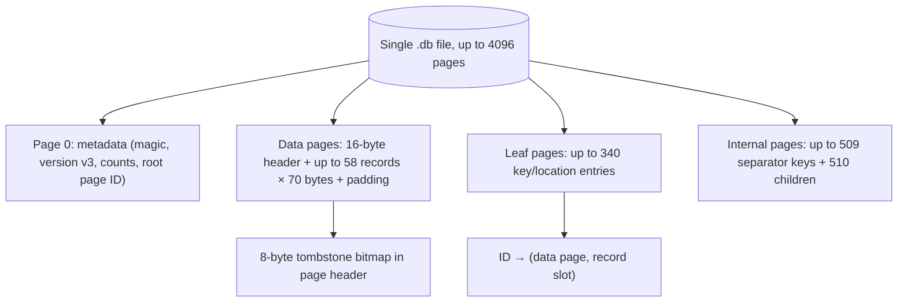
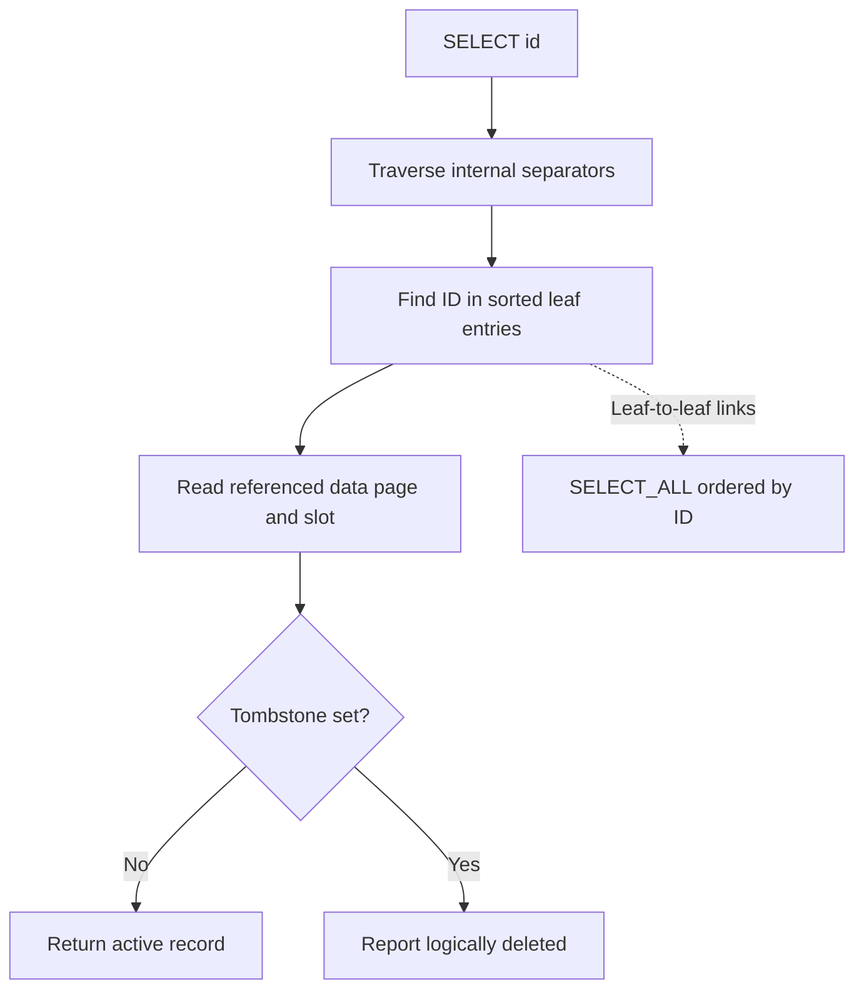

# MiniDB visual guide

MiniDB is an educational single-table database engine, not an Oracle-compatible or production database. These diagrams describe **disk format v3**. For byte-exact offsets and invariants, see [storage-format.md](storage-format.md) and [btree-design.md](btree-design.md).

## Interactive portfolio demonstration

The public [MiniDB showcase](https://minibd.pages.dev/) offers an interactive
architecture explorer, an **educational browser-only B+ Tree simulation**, a
simulated command terminal and a chart of recorded benchmarks. It does **not**
run the C17 engine or write persistent database files. The diagrams below
explain the actual C implementation and its v3 disk layout.

## From command to disk



**Ownership:** Main owns Storage. Storage owns Pager and B+ Tree state; the tree borrows Pager. Only the REPL formats terminal output. The Parser and Executor do not write data to disk themselves.

## Page organization



Page IDs determine positions in the file (offset = page ID × 4096). **Data and index pages may be interleaved** and page IDs alone do not reveal their type. The diagram groups page *kinds*, not contiguous regions.

## Indexed lookup and ordered scan



The B+ Tree indexes **ID**, not age. `SELECT_ALL WHERE age >= 21` traverses indexed entries and applies the age predicate to active records; it is not an age-indexed point lookup. Deleted IDs remain in leaves and do not reclaim disk space.

## A session that survives a restart

Build once, then run from the repository root:

```sh
cmake -S . -B build -DCMAKE_BUILD_TYPE=Debug -DBUILD_TESTING=ON
cmake --build build -j2
sh scripts/demo.sh ./build/minidb
```

The script uses `examples/demo.txt`, opens a fresh temporary database, closes it normally, then reopens the **same file** in a new process and queries its records. It cleans up temporary files. It does not modify any personal database. Closing normally syncs modified pages; **MiniDB provides no WAL or crash recovery guarantee**.

## Validate the implementation

```sh
ctest --test-dir build --output-on-failure
```

A GitHub Actions workflow runs Debug, Release and sanitizer configurations on pull requests and pushes to `main`. See [testing.md](testing.md) for what the 19 suites cover and [limitations.md](limitations.md) for unsupported guarantees.
